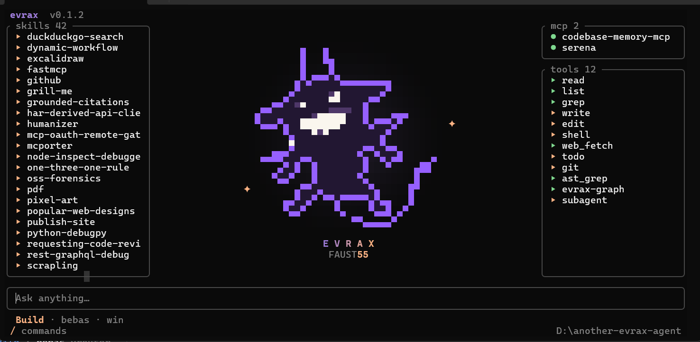
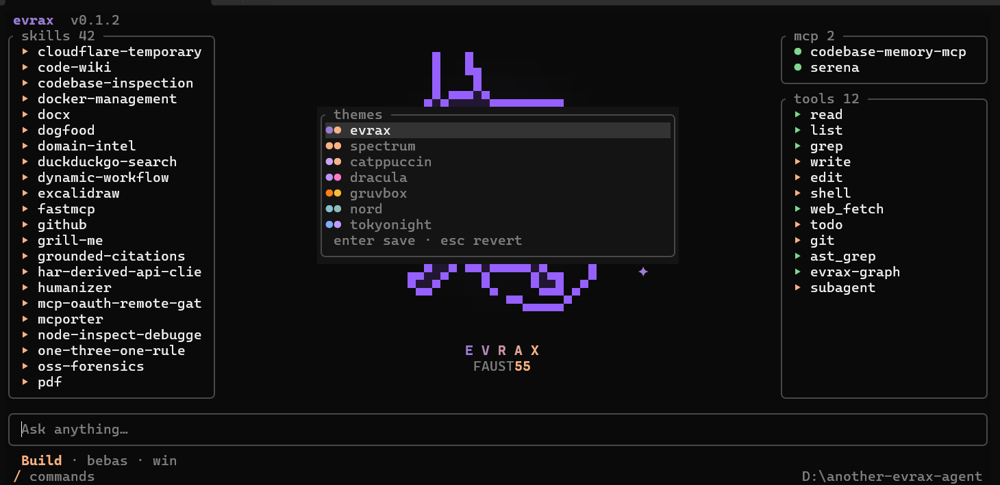

# evrax

Coding agent yang hidup di terminal. Ditulis dengan Rust + [ratatui](https://ratatui.rs):
satu binary kecil, hemat memori, backend LLM asli, plus web UI yang bisa dibuka dari HP.



## Fitur

- **Agent loop dengan tools** — `read`, `list`, `grep`, `write`, `edit`, `shell`,
  `web_fetch`, `todo`, `git`, `ast_grep`, `evrax-graph`, `subagent`.
- **Multi-provider** — simpan banyak endpoint (openai-compatible atau Anthropic
  native), daftar model diambil otomatis, ganti provider/model lewat `/model`.
- **Mode Plan / Build** — Plan membuat semua tool jadi read-only.
- **Approval** — tool yang mengubah file dan path di luar workspace minta izin
  dulu (Once / Always / Reject).
- **Sesi tersimpan di disk** — tiap project punya store sendiri, jadi bisa
  keluar lalu lanjut lagi kapan saja.
- **UI terminal nyaman** — transcript per sesi, judul otomatis (heuristik + LLM),
  `/rename`, command palette, slash menu, paste gambar dengan preview Kitty,
  tujuh tema warna.
- **Web remote** — `/remote` menyalakan web UI kecil di port 444: login password,
  token bearer, streaming SSE, prompt dan approval dari browser, plus tunnel
  Cloudflare.
- **Code graph** — `evrax-graph` meng-index repo ke SQLite dan menjawab pencarian
  simbol, callers/callees, impact, dead code, dan outline file.
- **Retry dan guardrail** — retry otomatis untuk 429/5xx/error jaringan, deteksi
  loop, dan notifikasi jelas saat langkah satu turn habis.



*Pemilih tema: tujuh tema bawaan, `Enter` untuk simpan, `Esc` untuk batal.*

## Install (Windows)

```powershell
irm https://raw.githubusercontent.com/jackielnikkie/another-evrax-agents/main/install.ps1 | iex
```

Perintah ini menaruh `evrax.exe` di `%USERPROFILE%\.evrax\bin` dan menambahkannya
ke PATH user. Tidak perlu admin.

Opsi lain:

```powershell
.\install.ps1 -Version v0.1.2        # pakai rilis tertentu
.\install.ps1 -LocalZip .\evrax.zip  # install dari zip lokal
.\install.ps1 -Uninstall             # hapus binary dan entri PATH
```

Semua flag (`-InstallDir`, `-System`, `-NoPath`, `-Purge`, ...) ada di
[`docs/install.md`](docs/install.md).

## Pertama kali jalan

Jalankan `evrax`. Kalau API key belum ada, wizard setup akan terbuka. Wizard ini
mendukung banyak provider sekaligus; provider bisa diganti kapan saja dengan
`/model`.

1. Pilih provider tersimpan, atau **tambah provider**.
2. Pilih protokolnya: **openai-compatible** (`/chat/completions`) atau
   **anthropic** (`/messages`).
3. Beri nama (mis. `Nimbus Go`, `Muse Spark`), lalu isi base URL
   (`◀/▶` mengisi preset: 9router, OpenRouter, DeepSeek, Custom).
4. Tempel API key lalu tekan `Enter` — evrax mengecek key dengan mengambil
   daftar model (`GET /models`). Belum perlu nama model.
5. Pilih model dari daftar (ketik untuk filter). Kalau gateway tidak punya
   `/models`, ketik nama model manual lalu `Enter`.
6. Cek ringkasan lalu simpan — backend langsung aktif, tanpa restart.

Konfigurasi ditulis ke `%APPDATA%\evrax\agent.json`:

```json
{
  "active": "Nimbus Go",
  "providers": [
    {
      "name": "Nimbus Go",
      "kind": "openai",
      "base_url": "https://api.example.com/v1",
      "api_key": "key-kamu",
      "model": "some-model"
    },
    {
      "name": "Muse Spark",
      "kind": "anthropic",
      "base_url": "https://api.example.com",
      "api_key": "key-kamu",
      "model": ""
    }
  ],
  "max_iterations": 500
}
```

File lama (satu provider) dimigrasi otomatis saat disimpan berikutnya. Bisa juga
lewat environment variable (`EVRAX_PROVIDER`, `EVRAX_BASE_URL`, `EVRAX_MODEL`,
`EVRAX_API_KEY`, `EVRAX_MAX_ITERATIONS`) atau flag CLI — nilainya hanya
menimpa provider aktif untuk run itu. Jalankan `evrax --setup` untuk membuka
wizard lagi, atau `/model` di dalam TUI untuk ganti provider/model.

## Pemakaian

```
evrax                        buka TUI dengan sesi baru
evrax -c                     lanjutkan sesi terakhir
evrax -s <id|prefix|judul>   lanjutkan sesi tertentu
evrax -l                     daftar sesi tersimpan
evrax --setup                buka wizard setup
evrax --provider <nama>      mulai dengan provider tersimpan
evrax --mock                 backend mock bawaan (tanpa API)
evrax --model <id>           override model
evrax --base-url <url>       override endpoint
evrax --max-iterations <n>   tool round per turn (default 500)
evrax --root <path>          pakai workspace lain
evrax --no-save              jangan simpan sesi ke disk
evrax --help                 tampilkan semua flag
```

Keyboard:

| Tombol | Fungsi |
| --- | --- |
| `Enter` | kirim prompt |
| `Tab` | ganti Plan / Build |
| `Ctrl+P` | command palette |
| `Ctrl+N` | sesi baru |
| `Ctrl+O` | daftar sesi |
| `Ctrl+Y` | copy balasan terakhir |
| `Ctrl+C` | keluar |

Slash command: `/new`, `/sessions`, `/mode`, `/copy`, `/theme`, `/model`,
`/remote`, `/rename <judul>`, `/exit`. `/model` menampilkan provider tersimpan,
mengambil daftar model saat dibutuhkan, dan mengganti provider/model aktif tanpa
restart.

## Sesi

Sesi disimpan per project di `%LOCALAPPDATA%\evrax\projects\<project>-<hash>\`.
Transcript dan history agent disimpan setelah setiap turn, jadi `evrax -c`
melanjutkan tepat dari posisi terakhir. Pakai `evrax -l` untuk melihat id,
waktu, dan judul.

## Web remote

Ketik `/remote` di TUI untuk menyalakan web UI untuk sesi ini. Default-nya
listen di port 444 dan dilindungi password yang kamu set di dialog. Dialog yang
sama menampilkan URL LAN dan bisa menyalakan tunnel Cloudflare. Bind address,
port, dan public URL disimpan di `%APPDATA%\evrax\remote.json`.

## Build dari source

Toolchain di-pin ke GNU Windows di `rust-toolchain.toml`:

```sh
cargo build --release -p evrax-tui   # -> target\release\evrax.exe
cargo test --workspace
cargo clippy --workspace --all-targets -- -D warnings
```

## Struktur project

```
crates/evrax-core     kontrak backend (TurnRequest, AgentEvent, AgentBackend)
crates/evrax-agent    backend SSE, agent loop, tools, catalog
crates/evrax-remote   server web remote, SSE, tunnel
crates/evrax-store    penyimpanan project dan sesi
crates/evrax-tui      aplikasi TUI (binary: evrax)
evrax-graph/          indexer code graph dan CLI
skill-evrax/          skill yang dimuat catalog
docs/                 peta kode, install, remote/tunnel, tema
```

Peta modul dan alur kode: [`docs/code-map.md`](docs/code-map.md).

## Lisensi

MIT — lihat [LICENSE](LICENSE).
